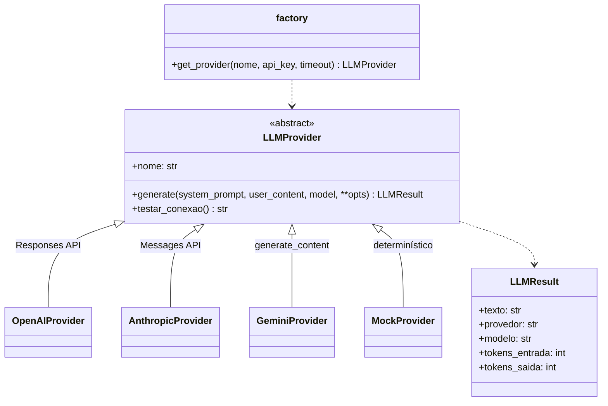
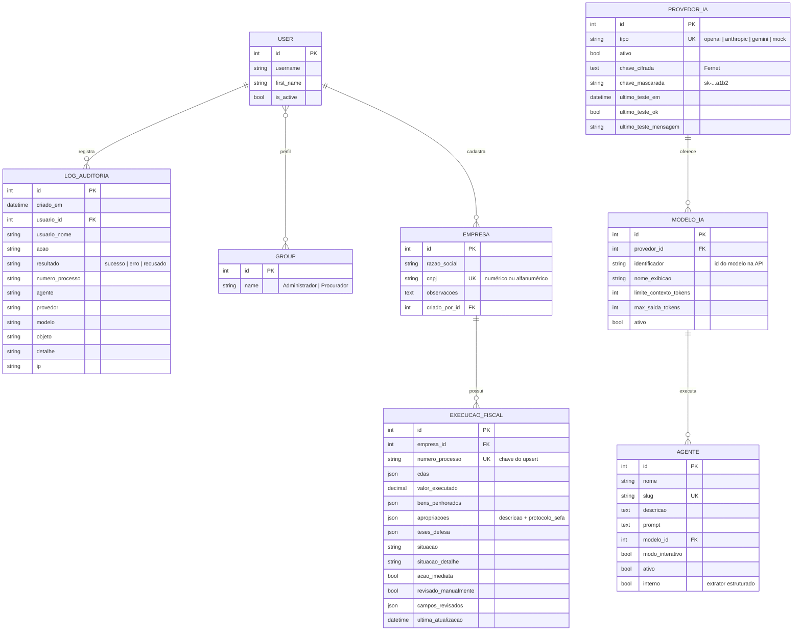

# Arquitetura do FISCO.IA

Este documento complementa o [README](../README.md) com o modelo de dados, a organização em
camadas e as decisões técnicas do protótipo.

## Camadas

| Camada | Responsabilidade | Onde |
|---|---|---|
| Apresentação | Templates Django, Bootstrap 5 e HTMX; views finas que só validam a entrada e delegam | `templates/`, `apps/*/views.py` |
| Aplicação | Regras de negócio dos sete módulos | `apps/*/services/`, `apps/*/services.py` |
| Integração | Contrato único com os provedores de IA | `apps/provedores/llm/` |
| Dados | PostgreSQL (dados persistentes) e cache com expiração (sessões) | `apps/*/models.py`, `config/settings.py` |

### Camada de integração

- Os erros de cada SDK são traduzidos para uma hierarquia própria (`LLMAutenticacaoError`,
  `LLMConexaoError`, `LLMLimiteError`, `LLMRecusaError`), com mensagens seguras para o usuário.
- A opção `tarefa` (`escopo`, `perguntas`, `analise`, `parcial`, `consolidacao`, `extracao`) é
  ignorada pelos provedores reais, cujo comportamento vem do prompt. O MockProvider a usa para
  escolher a resposta de exemplo.
- `provedores.services.gerar(modelo, ...)` é o único ponto de entrada usado pelos módulos de
  aplicação. Em modo demonstração, todas as chamadas vão para o MockProvider.

## Modelo de dados

Não existe tabela de análises. O conteúdo dos autos e o texto das análises não são
persistidos no banco (veja a próxima seção).

## Decisões técnicas

### Ciclo de vida dos dados processuais (LGPD)

| Dado | Onde fica | Por quanto tempo |
|---|---|---|
| PDF enviado | Memória ou arquivo temporário do próprio Django durante a requisição | Até o fim da requisição |
| Texto extraído (análise direta) | Memória | Até o fim da requisição |
| Texto extraído (modo interativo) | Arquivo em `FISCO_TEMP_DIR`, com nome UUID | Até a análise final ou o cancelamento; arquivos órfãos são removidos por expiração (`limpar_temporarios`) |
| Resultado da análise | Sessão do usuário, em cache de arquivos com expiração (`SESSION_ENGINE=cache`) | Duração da sessão (`FISCO_SESSAO_MINUTOS`) ou fechamento do navegador |
| Dados da tabela consolidada | PostgreSQL | Permanente (apenas os campos especificados) |
| Log de auditoria | PostgreSQL | Permanente, somente metadados |

### Verificação de escopo

1. Heurística por expressões regulares (execução fiscal, Lei 6.830/80, CDA, Certidão de Dívida
   Ativa, Fazenda Pública, dívida ativa). Sem nenhum termo, o documento é recusado sem
   chamar o modelo.
2. Checagem rápida pelo modelo com uma amostra de até 12 mil caracteres e resposta em JSON.
3. Se o JSON não puder ser interpretado, vale a heurística (mínimo de dois termos).

### Map-reduce

- Orçamento de entrada = `limite_contexto × 0,9 − max_saida − tokens do prompt`.
- O texto é dividido preservando folhas inteiras (`--- [fl. N] ---`); uma folha maior que o
  orçamento é fatiada.
- **Map:** cada bloco recebe o prompt do agente e uma instrução de análise parcial.
- **Reduce:** as parciais são consolidadas. Se não couberem juntas, a consolidação é feita
  hierarquicamente, em grupos.
- O modelo de demonstração tem contexto de 8 mil tokens para que o PDF de exemplo extenso
  acione o map-reduce.

### Modo interativo

O modelo recebe o prompt de esclarecimento e as instruções do agente, e devolve
`{"perguntas": [{"id", "pergunta", "referencia"}]}`. A resposta é validada: no máximo 5
perguntas, tamanho limitado e itens malformados descartados. JSON inválido equivale a "sem
perguntas", e a análise segue normalmente. As respostas do procurador entram no conteúdo
enviado ao modelo sob o título `ESCLARECIMENTOS DO PROCURADOR`.

### Tabela consolidada

- O agente interno `extracao-estruturada` devolve JSON, que é validado e normalizado
  (`DadosExecucao`): datas e valores em formato brasileiro, situação restrita aos códigos
  válidos e listas deduplicadas e limitadas.
- O upsert usa `select_for_update` pelo número do processo. Um processo vinculado a outra
  empresa não é sobrescrito.
- Campos alterados pelo procurador entram em `campos_revisados` e são preservados nas
  próximas extrações.

### Segurança

- `LoginRequiredMiddleware`: toda view exige login, exceto login e verificação de saúde.
- Mixins `AdministradorMixin` e `ProcuradorMixin` devolvem 403. Os menus usam as mesmas
  funções de perfil.
- Chave mestra Fernet lida do ambiente. No Docker, quando ausente, é gerada uma única vez no
  volume `webdata`.
- O Markdown gerado pelos modelos é convertido e sanitizado com `nh3`: tags restritas, sem
  atributos e sem URLs.
- O log de auditoria bloqueia `save()` de registros existentes, `delete()`, `update()` e
  `delete()` em massa.
